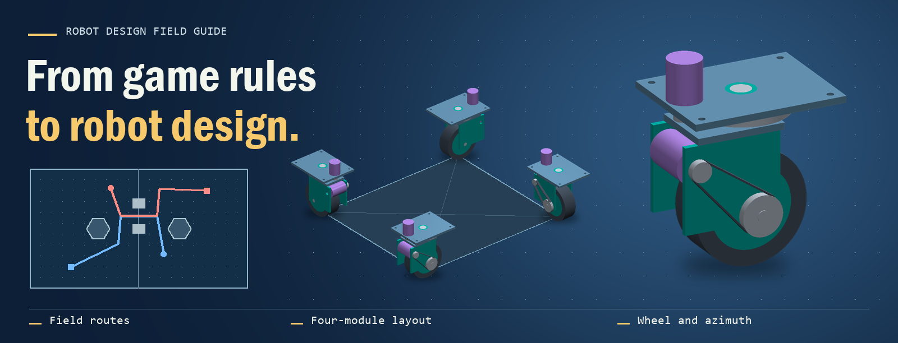

# Agent FRC

[](https://ehartye.github.io/agent-frc/)

*Classroom field study and original swerve teaching assembly, shown at four mounting positions and in detail. [Open the editable Fusion model](examples/swerve/independent-swerve.f3d).*

Agent FRC helps students turn a new game manual into robot design decisions. Open the [interactive workflow guide](https://ehartye.github.io/agent-frc/) to try the field lab and see which skills support each step.

1. **Model the rules.** Set up the [student project structure](skills/frc-project-setup/SKILL.md). Read the supplied manual and drawings at the project's evidence cutoff. Build a [source-linked rules register and field profile](docs/project-rules-model.md) in the team's project.
2. **Rehearse the match.** Explore the field with a robot-sized box. Compare scoring windows, supply, red and blue routes, finite footprints and time lost at choke points in the [field lab](docs/kickoff-field-lab.md).
3. **Choose a strategy.** Compare candidate roles against matched partners, opponents and traffic in the [season meta lab](docs/season-meta-lab.md). Turn student observations into a [match narrative](docs/game-to-robot-strategy.md), an alternative, a measurable requirement and the experiment that will resolve the choice.
4. **Design and check the robot.** Follow the [three phase exit criteria](docs/design-phase-detail.md) for [conceptual design](skills/frc-conceptual-design/SKILL.md) (field scenarios and trade studies), [preliminary design](skills/frc-preliminary-design/SKILL.md) (shared assembly layout) and [detailed design](skills/frc-detailed-design/SKILL.md) (native assembly and fabrication package). [Compare whole-robot architectures](docs/whole-robot-comparison.md) under the same nominal and adverse conditions. After selecting the field role, [check a shared package issue](docs/preliminary-design.md) before detailed Fusion CAD. Reopen the upstream decision when its accepted condition changes. Check the installed revision for [sustainable scoring rate, supported robot weight and service recovery](docs/mechanism-hardening.md). Hand off an [editable blockout](docs/design-artifact.md) and [subsystem interfaces](docs/subsystem-contracts.md). Default to a four-module [swerve drivetrain](skills/frc-swerve/SKILL.md) with an [original Fusion teaching model](examples/swerve/README.md). Review [native viewer evidence](docs/native-viewer-contracts.md) and [simulation traces](docs/simulation-checks.md).
5. **Share robot evidence.** Build a project-owned [robot highlights page](skills/frc-robot-highlights/SKILL.md) with explorable CAD, mechanism animations, the current configuration and sourced results.
6. **Resume the investigation.** Recover the owner's decision, current candidate and most recent test with the [continuation guide](docs/strategy-first-continuation.md).

## Install the plugin

```sh
claude plugin marketplace add ehartye/agent-frc
claude plugin install agent-frc@agent-frc-marketplace

codex plugin marketplace add ehartye/agent-frc
codex plugin add agent-frc@agent-frc-marketplace
```

In a Claude Code session, `/plugin install agent-frc --marketplace ehartye/agent-frc` does the same. The [install guide](docs/local-plugin.md) covers updates, running plugin commands from an installed copy and loading a development checkout with `claude --plugin-dir`.

## Run from a checkout

Compare the voltage available to a device when two loads overlap or run at different times. Try the [shared electrical supply exercise](docs/shared-power-review.md), then compare regulator settings against the loaded floor and settled connector ceiling in the [two-trim example](examples/power/regulator/comparison.json).

To check whether a robot could reach an observed score, compare the moving bodies with the assembled robot and installed field through the event. See the [field-route evidence guide](docs/field-route-evidence.md).

To check repeatability across several starts, use the [frozen mission cohort guide](docs/mission-cohort.md).

To repeat a geometric check on a saved Fusion assembly, use the [native study replay procedure](docs/native-study-replay.md). It verifies the document and geometry before testing the chosen poses.

Use Node.js and npm. The same commands run from an installed copy. The plugin works with project files and has no required vault or robot connection.

```sh
npm run validate
npm run test:changed
npm run rules -- init ../robot-project/register.json
npm run rules -- compile ../robot-project/register.json ../robot-project/field-profile.json ../robot-project/reviewed-rules.json
npm run kickoff -- --profile ../robot-project/reviewed-rules.json --output ../robot-project/field.html
```

`npm run test:changed` runs the tests that cover the files you changed; see [how the plugin tests itself](docs/project-ci.md#how-the-plugin-repository-tests-itself) for the full suite and the other runs. Fill the register and field profile from the team's sources before compiling. Open the generated HTML locally. For a quick trial, run the last command with [the invented training field](examples/kickoff/training-field.json) as the profile. Outputs use new filenames to preserve prior revisions.

New robot blockouts default to two rear plan-view chamfers. Download the editable frame plan from the workflow guide or generate a Fusion sketch from the [project frame and bumper profile](docs/frame-profile.md).

For a project with `iterations/active.json`, follow its active design root before recovering older records. After a decision to start over, use `frc-start-over` to preserve the evidence and open a fresh numbered design. [Design iterations](docs/design-iterations.md)
