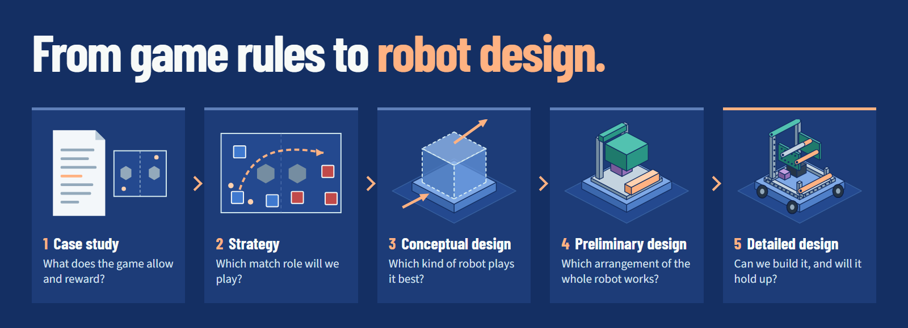

# Agent FRC

[](https://ehartye.github.io/agent-frc/)

Agent FRC is a plugin for coding agents. It takes a student team from a new game manual to a robot design they can build, one decision at a time. The students make the decisions. The agent reads, models, measures and keeps the record. [Open the interactive guide](https://ehartye.github.io/agent-frc/) or [try the field lab](https://ehartye.github.io/agent-frc/field-lab.html).

## Five phases

Each phase settles one decision and hands its record to the next.

| Phase | The decision | What goes in | What comes out |
| --- | --- | --- | --- |
| **1. [Case study](skills/frc-case-study/SKILL.md)** | What does the game allow and reward? | The manual, its updates and the field drawings | The game's rules with their sources, a field model and the field lab |
| **2. [Strategy](skills/frc-strategic-narrative/SKILL.md)** | Which match role will we play? | The rules, and what students saw in the field lab | The chosen role, its match story and fallback, and the requirements it sets |
| **3. [Conceptual design](skills/frc-conceptual-design/SKILL.md)** | Which kind of robot plays it best? | The role, its requirements and the rules | The concept the student chose and why, with how far it can slip before the choice changes |
| **4. [Preliminary design](skills/frc-preliminary-design/SKILL.md)** | Which arrangement of the whole robot works? | The match story and the chosen concept | A blockout of the robot that moves through the whole match cycle, its trials, one review page and a handoff |
| **5. [Detailed design](skills/frc-detailed-design/SKILL.md)** | Can we build it, and will it hold up? | The preliminary design the team accepted | A Fusion assembly, the package to make it from and a readiness verdict |

A later phase can send work back. When a concept can't meet its requirements, or a detailed part can't fit the space reserved for it, the decision that made it reopens. [What ends each phase](docs/design-phase-detail.md)

Other skills help in any phase: [drivetrain](skills/frc-swerve/SKILL.md), [robot code](skills/frc-java/SKILL.md), [driver and autonomous modes](skills/frc-modes/SKILL.md), [vision](skills/frc-vision/SKILL.md), [troubleshooting](skills/frc-troubleshoot/SKILL.md), [showing the robot](skills/frc-robot-highlights/SKILL.md) and [starting over](skills/frc-start-over/SKILL.md).

## See it on real games

Three proof-of-concept projects use the plugin on past games. Each keeps its own rules, field, designs and results.

| Project | Open |
| --- | --- |
| [2024 proof of concept](https://github.com/ehartye/frc-2024-poc) | [Design review](https://ehartye.github.io/frc-2024-poc/preliminary-design/) · [Field lab](https://ehartye.github.io/frc-2024-poc/field-lab.html) |
| [2025 proof of concept](https://github.com/ehartye/frc-2025-poc) | [Design review](https://ehartye.github.io/frc-2025-poc/preliminary-design/) · [Field lab](https://ehartye.github.io/frc-2025-poc/field-lab.html) |
| [2026 proof of concept](https://github.com/ehartye/frc-2026-poc) | [Design review](https://ehartye.github.io/frc-2026-poc/preliminary-design/) · [Field lab](https://ehartye.github.io/frc-2026-poc/field-lab.html) |

## Install the plugin

```sh
claude plugin marketplace add ehartye/agent-frc
claude plugin install agent-frc@agent-frc-marketplace

codex plugin marketplace add ehartye/agent-frc
codex plugin add agent-frc@agent-frc-marketplace
```

In a Claude Code session, `/plugin install agent-frc --marketplace ehartye/agent-frc` does the same. Then ask the agent to set up a project for this year's game. The plugin works on your project's files and never connects to a robot.

[Update, run commands from an installation, or develop from a checkout](docs/local-plugin.md) · [How the plugin tests itself](docs/project-ci.md#how-the-plugin-repository-tests-itself)
