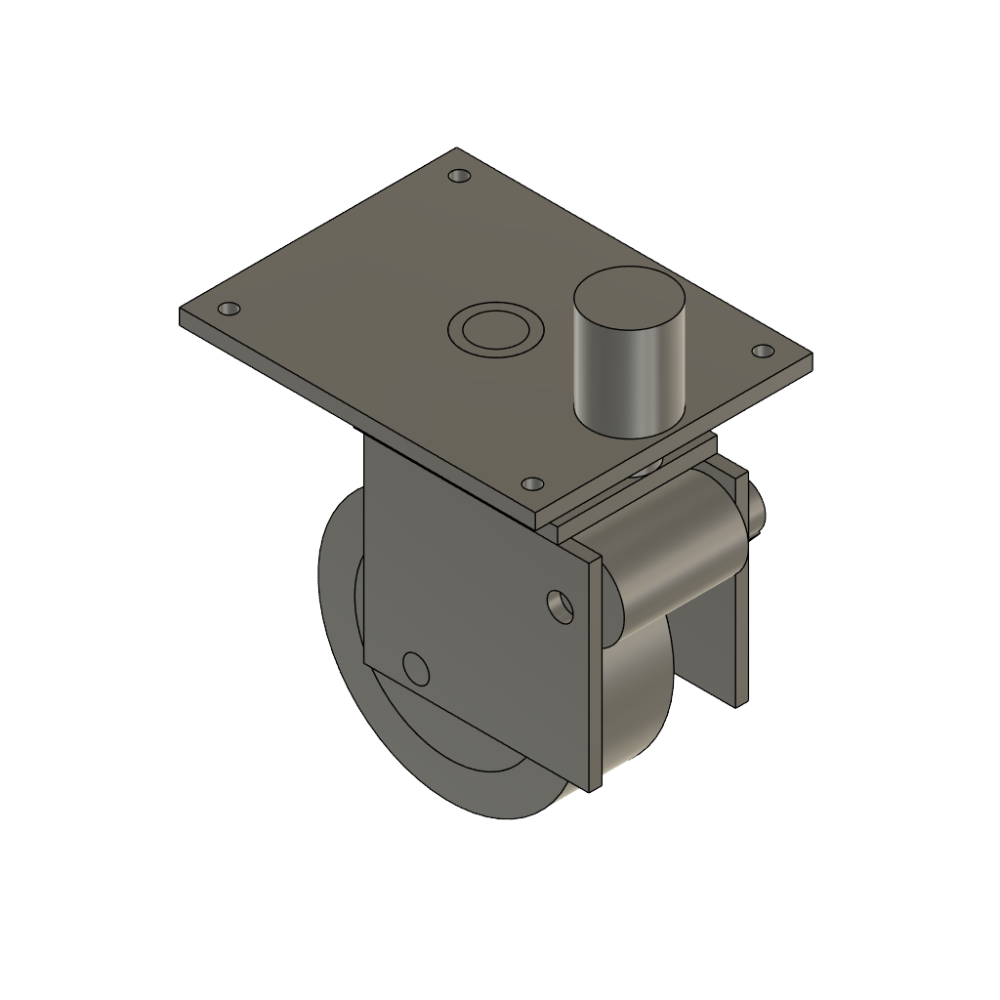

# Agent FRC

[](examples/swerve/independent-swerve.f3d)

*Plugin teaching example · Independent-axis swerve module, as saved in Fusion.*

Agent FRC helps students turn a new game manual into robot design decisions. Open the [interactive workflow guide](https://ehartye.github.io/agent-frc/) to try the field lab and see which skills support each step.

1. **Model the rules.** Set up the [student project structure](skills/frc-project-setup/SKILL.md). Read the supplied manual and drawings at the project's evidence cutoff. Build a [source-linked rules register and field profile](docs/project-rules-model.md) in the team's project.
2. **Rehearse the match.** Explore the field with a robot-sized box. Compare scoring windows, supply, red and blue routes, finite footprints and time lost at choke points in the [field lab](docs/kickoff-field-lab.md).
3. **Choose a strategy.** Turn student observations into a [match narrative](docs/game-to-robot-strategy.md), an alternative, a measurable requirement and the experiment that will resolve the choice.
4. **Design and check the robot.** Hand off an [editable blockout](docs/design-artifact.md) and [subsystem interfaces](docs/subsystem-contracts.md). Default to a four-module [swerve drivetrain](skills/frc-swerve/SKILL.md) with an [original Fusion teaching model](examples/swerve/README.md). Review [native viewer evidence](docs/native-viewer-contracts.md) and [simulation traces](docs/simulation-checks.md).
5. **Share robot evidence.** Build a project-owned [robot highlights page](skills/frc-robot-highlights/SKILL.md) with explorable CAD, mechanism animations, the current configuration and sourced results.
6. **Resume the investigation.** Recover the owner's decision, current candidate and most recent test with the [continuation guide](docs/strategy-first-continuation.md).

## Run from a checkout

Compare the voltage available to a device when two loads overlap or run at different times. Try the [shared electrical supply exercise](docs/shared-power-review.md), then supply the project's own traces and operating requirements.

To check whether a robot could reach an observed score, compare the moving bodies with the assembled robot and installed field through the event. See the [field-route evidence guide](docs/field-route-evidence.md).

To check repeatability across several starts, use the [frozen mission cohort guide](docs/mission-cohort.md).

To repeat a geometric check on a saved Fusion assembly, use the [native study replay procedure](docs/native-study-replay.md). It verifies the document and geometry before testing the chosen poses.

Use Node.js and npm. See the [local marketplace guide](docs/local-plugin.md) to stage and install this checkout. The plugin works with project files and has no required vault or robot connection.

```sh
npm test
npm run validate
npm run rules -- init ../robot-project/register.json
npm run rules -- compile ../robot-project/register.json ../robot-project/field-profile.json ../robot-project/reviewed-rules.json
npm run kickoff -- --profile ../robot-project/reviewed-rules.json --output ../robot-project/field.html
```

Fill the register and field profile from the team's sources before compiling. Open the generated HTML locally. For a quick trial, run the last command with [the invented training field](examples/kickoff/training-field.json) as the profile. Outputs use new filenames to preserve prior revisions.
